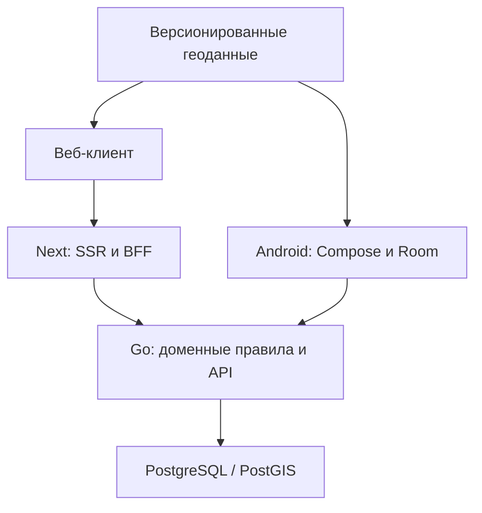
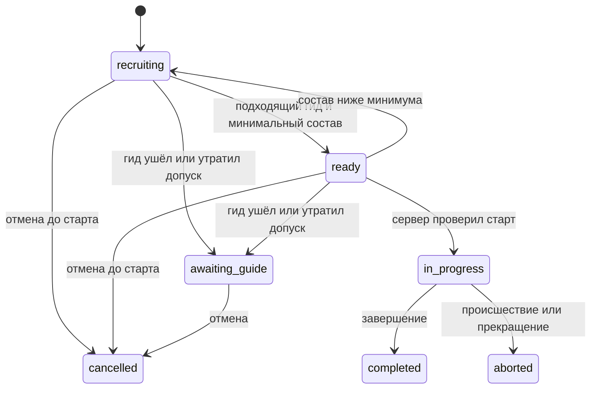

# Архитектура Тропника

Документ обновлён по исходникам 13 ноября 2026 года. Источники документа — [контракт API](../contracts/api.ts), [OpenAPI](../contracts/openapi.yaml), [backend](../backend/README.md), [Android](../android/README.md), [инфраструктура](../infra/README.md) и [происхождение геоданных](data-provenance.md). Реализация и успешно выполненная сборка не означают развёрнутый production-сервис; фактические проверки перечислены отдельно в [приёмке](acceptance.md).

TS-контракт имеет один источник: `web/lib/contract.ts`. Публичный
`contracts/api.ts` переэкспортирует только типы из него, сохраняя имена
и идентичность символов без runtime-зависимости. Проверка TypeScript
в `tools/pages-preview/tests/api-contract.test.mjs` удостоверяет все экспорты.
Канонические декларации остаются внутри `web/`, поэтому отдельно размещённый
Site не зависит от соседних каталогов монорепозитория. Проверяемые HTTP
границы и схемы OpenAPI дополняют типы, а не заменяются приведением `as`.

## 1. Компоненты и авторитетные данные

Веб использует Next 16, React 19 и TypeScript. Для private preview предусмотрен адаптер Vinext; независимый self-host запускает обычный Next через `build:next` / `start:next`. Браузер обращается к same-origin BFF, который хранит непрозрачный сеанс в HttpOnly cookie и передаёт Bearer серверу. JSON с токеном браузеру не возвращается. Native Android вызывает тот же Go API по HTTPS напрямую и хранит токен через Android Keystore.

Go является авторитетом для состава группы, допуска гида, места, статуса, модерации и права чтения переписки. PostgreSQL хранит изменения атомарно. Room и браузерные хранилища обеспечивают локальное чтение, но не подтверждают новое бронирование или разрешение на старт. Офлайн-карта должна оставаться доступной при истечении сеанса и при происшествии.

Если API не задан, веб и APK показывают справочные/локальные функции и честное неподключённое социальное состояние. Нет встроенной базы вымышленных аккаунтов, рейтингов или сообщений. Недоступность настроенного API также не должна становиться ложным `404` маршрута или подтверждением выполненного действия.

## 2. Маршрут, версия и конкретный выход

| Объект | Ответственность |
|---|---|
| `Route` | Идентичность маршрута, направление, публикация и текущая рассмотренная версия |
| `RouteRevision` | Неизменяемые геометрия, происхождение, сведения о проверке, сложность и политика группы |
| `RecruitmentRequest` | Интерес к маршруту и отдельный чат; наличие интереса не означает забронированное место |
| `Departure` | Дата/часовой пояс, назначенный гид, ссылка на конкретную версию, вместимость, статус и optimistic version |
| `Membership` | Пользователь, роль в конкретном выходе и состояние участия/фактического присутствия |
| `Message` | Закрытая переписка участников, стабильный `clientId`, время и видимость |
| `Review` | Отзыв фактического завершившего участника по одному объекту: гид или маршрут |
| `Report`, `ModerationAction`, `Appeal` | Жалоба на доступный объект, решение с причиной и независимый пересмотр |

Импортированные линии первоначально справочные. Они не публикуются как разрешённые выходы автоматически. Публикация через операторский процесс фиксирует рассмотренную версию и политику состава. Обновление источника не переписывает историю старого выхода; при старте проверяется, что закреплённая версия ещё актуальна и открыта.

Минимум продукта — **четыре человека всего, включая одного гида**. `minPeople` конкретной версии может быть выше. `maxGroupSize` ограничивает вместимость, `requiredGuides` задаёт требование к сопровождению. Текущая модель допускает только одного назначенного гида и отвергает маршрут с требованием нескольких. Это ограничение реализации, а не универсальная норма для любых походов.

## 3. Состояние похода и конкурентные изменения

`ready` означает достаточный подтверждённый состав, но само по себе не означает физическую явку и не даёт клиенту право запускать поход. Перед `in_progress` сервер повторно проверяет время, открытую текущую версию, подходящую квалификацию до окончания выхода, присутствие самого гида и достаточное число `checked_in`. Неявившийся участник не получает право на отзыв.

Изменения состава сериализуются блокировкой строки `Departure`. Уникальный ключ участия считает гида один раз; ограничение вместимости дополнительно защищено триггером. Идемпотентность связана с операцией и содержимым запроса: повтор того же запроса не занимает второе место, а переиспользование ключа с другими данными конфликтует. `expectedVersion` позволяет клиенту обнаружить устаревшее состояние.

После старта нельзя обычным выходом из группы удалить человека из фактического состава. Отзыв квалификации блокирует новый старт, но не лишает уже назначенного гида возможности отметить прекращение или завершение текущего выхода. Это сохраняет возможность фиксировать происшествие вместо потери управления.

## 4. Авторизация, роли и приватность

Регистрация выбирает `tourist` или `guide`; у гида появляется статус заявки, а не автоматически подтверждённая квалификация. Квалификации имеют область, ограничения и срок действия; оператор вводит результат реального рассмотрения и источник доказательства. Профиль гида не означает допуск на любую местность.

`staffRole` — отдельное поле `none`, `moderator` или `admin`. Публичного API самоназначения нет. Операторский CLI запрещает менять собственную staff-роль и подтверждать собственную квалификацию. При каждом модерационном действии актуальные полномочия перечитываются из БД; старый сеанс не сохраняет отозванное право.

Закрытый чат доступен участникам соответствующего набора/похода. Назначенный гид получает минимальный roster для отметки присутствия, без контактов и лишних персональных полей. Модератор не получает произвольный просмотр всех чатов: очередь отдаёт только обжалованный материал, необходимые идентификаторы и объяснение. Недопустимые субъект, уровень и конфликт интересов исключаются до выдачи содержания. Чтения очереди и решения записываются в аудит.

Пароли хешируются PBKDF2-SHA256 с индивидуальной солью; сервер сохраняет только хеш случайного токена сеанса. Browser BFF проверяет origin изменения, ограничивает тело и не следует редиректам API. При локальном выходе с потерянной связью клиент различает удалённый токен на устройстве и неподтверждённый отзыв серверного сеанса. Чаты не являются E2EE: API обрабатывает их содержание.

## 5. Антиспам, решения и отзывы

Перед новой публикацией берётся пользовательская блокировка PostgreSQL. Лимиты учитываются между каналами и API-репликами; состояние процесса не является единственным счётчиком. Нормализуются Unicode и невидимые управляющие символы, вычисляется канонический отпечаток, проверяются повторы, частота и число распознаваемых ссылок. Сервер не загружает присланные URL.

Это ограниченные, настраиваемые эвристики, не AI-классификатор и не гарантия выявления спама. Повтор ранее принятого сообщения с тем же `clientId` распознаётся до нового расходования лимита. Непринятая операция возвращает ошибку и не помечается клиентом как доставленная.

Жалоба не скрывает сообщение автоматически. Допустимый модератор принимает решение с обязательной причиной: отклонить, скрыть, временно ограничить публикации либо совместить два действия. Срок ограничения — от одного часа до семи дней; `expiresAt` относится к ограничению публикаций. Скрытие остаётся до отмены соответствующего решения. При отмене одного решения сохраняются другие действующие основания.

Пользователь может подать апелляцию и жалобу, находясь под ограничением. Пересмотр не может выполнять субъект, первоначальный заявитель или первоначальный модератор. Ограничение не блокирует карту, выход из группы, явку, отмену или фиксацию происшествия. Отправка жалобы не является экстренной связью.

Отзыв создаётся только после фактического завершения участия; на одну цель в одном выходе — не более одного. Гид не оценивает собственную работу. Скрытые отзывы исключаются из публичного агрегата. Награды кабинета производятся из завершений и допустимых отзывов с `evidenceId`, временем и видом события. Они не подтверждают профессиональный допуск и не награждают опасный стиль поведения. Физическая явка остаётся утверждением гида; защита от сговора не реализована.

## 6. Офлайн и синхронизация

| Данные/операция | Локальное поведение | Когда нужен сервер |
|---|---|---|
| Пилотная карта, подписи и DEM | Файлы с границами и SHA256 сохраняются целиком | Для получения обновлённого пакета |
| Сохранённая карточка | Доступна с источником, версией и последним известным режимом | Для свежего режима/публикации |
| GPS устройства | Разовое foreground измерение при разрешении; остаётся локально | Передача позиции в сервис не реализована |
| Сообщение Android | Зашифрованный локальный кэш/очередь, разделённые по origin и пользователю | Для подтверждения отправки и чтения актуальной модерации |
| Новое участие и старт | Локальное намерение не создаёт подтверждение | Для атомарной проверки места, допуска, состава и версии |
| Наблюдение о выходе | `clientId`, время и базовая версия | Ack сообщает конфликт; всегда `serverAuthorized:false` |

Отключённое устройство не может узнать, что после скачивания у гида отозван допуск или участок закрыт. В интерфейсе нельзя обещать стопроцентную актуальность офлайн. Навигационные материалы при этом должны оставаться доступными.

Основной Android-клиент нативный; карта работает на общем с вебом `CustomMapEngine` в ограниченном WebView. Android передаёт команды через message port с проверкой точного origin и поколения; отдельный посредник допускает только рассмотренные ресурсы карты, без токенов аккаунта. MapLibre, Leaflet и Protomaps удалены из рабочего runtime. Общий renderer не подменяет платформенные контроллеры: подключение слоя каталога и режимов на Android проверяется отдельно. [Устройство собственной карты](custom-map.md).

Для отдельной автономной DEM-сцены сохраняется другой изолированный локальный WebView без сети, токенов или интерфейса сообщений карты. Она использует 513×513 числовых высот из архивированных DEM-тайлов; прежняя 129×129 сетка сохранена как preview и источник аудита. Эта сцена не входит в главные веб-режимы «Рельеф» и «Спутник». Увеличение плотности представления не повышает точность исходной съёмки. Цвет материала процедурный, без утверждения о наблюдаемой растительности или текущей погоде.

Android проверяет размер и SHA документа до загрузки, удерживает один WebView за карточкой и при открытии использует готовый экземпляр. Lifecycle owner входит в ключ экземпляра; pause/resume и освобождение renderer отделены от сети и авторизации. Скрытая сцена не принимает действия и скрыта от accessibility. Эти свойства реализованы и собраны, но взаимодействие на физическом устройстве не проверено.

Область показа РФ имеет общую исходную геометрию, display-представление 0…360 и каноническое −180…180. Собственный движок поддерживает непрерывную долготу и соседние копии мира; камера, маска, подписи и маршруты используют согласованное преобразование. Маска закрывает внешнюю область карты; события, маркеры и GPS проходят проверку покрытия. Обзорный zoom учитывает viewport и перекрывающие его панели. Подробная тайловая подложка готовится для текущей области, а неполная замена не стирает предыдущий готовый кадр. Поколение запроса и фактическое покрытие не позволяют позднему ответу вернуть устаревший слой. Единственное рассмотренное береговое исключение относится к точной геометрии «Чёрного ключа»; общая маска не расширяется. Источник, возраст и выбранные территории сохранены в provenance: это область интерфейса, не актуальный юридический реестр границ.

Веб-пакет содержит 193 MVT, 21 DEM и локальную сцену; покрытие только Бзерпинское. Сохранение карточки, сохранение подробной карты и сохранение рельефа — разные действия и объёмы. Последующие скрытия сообщений нельзя надёжно получить курсором только по `createdAt`; активный клиент обновляет свежий блок сообщений. Удалить ранее скачанный текст с отключённого устройства сервер не может.

## 7. Происхождение, публикация и SEO

OSM relations и отдельные way-сегменты не смешиваются с организованными выходами. Исходные разрывы и ветви сохраняются: пропущенные участки не дорисовываются. `geometryLengthKm` — сумма сегментов, а не автоматически официальная длина похода. Дата выгрузки, дата чтения источника, публикация уведомления и будущая перепроверка хранятся отдельно.

Геометрия OSM лицензируется отдельно от личных записей. Шрифты, MVT, схема OpenMapTiles, DEM и код имеют собственные уведомления. Сборка пакета сохраняет их и проверяет manifest перед публикацией локальной записи. Истечение срока перепроверки не отменяет найденное закрытие. Интернет-описание конкретного места не распространяется на весь импортированный трек.

Публичная индексация управляется явной конфигурацией. Sitemap включает содержательные опубликованные страницы, а не весь сырой импорт. Закрытый сезонный участок не требует автоматически удалять полезную опубликованную страницу: она сохраняет датированный режим. Личные страницы и переписка защищаются авторизацией независимо от robots. Ошибка настроенного источника данных не подменяется отсутствием записи.

## 8. Развёртывание и оставшиеся системы

Compose разделяет владельца миграций и runtime-права API. Production отвергает demo-конфигурацию, опасные роли БД и неподходящий HTTPS origin. Для внешнего PostgreSQL требуется проверяемый TLS; исключение частной Docker-сети задаётся явно. Прокси-заголовки доверяются только заданным прямым peer CIDR, ingress должен перезаписывать их по реальному соединению.

Подтверждение email, восстановление пароля, отзыв сеансов и закрытие аккаунта реализованы. Миграция 007 добавляет отдельную шифрованную очередь почты в Postgres: регистрация и уведомления о смене пароля связаны с ней транзакционно. AES-GCM использует независимый внешний ключ; получатель, тело письма и исходный токен не записываются в очередь открытым текстом. Обработчики забирают задания через ограниченные по времени lease; запоздалое подтверждение не может изменить новый lease. Повтор после перезапуска сохраняет тот же токен и Message-ID. Предел очереди, число попыток, сроки жизни и очистка ciphertext ограничены. Принятие SMTP не подтверждает доставку в ящик; повторы возможны. [Контракт почты и ключа](../backend/README.md).

Закрытие аккаунта обезличивает профиль и учётные данные с сохранением необходимой истории и аудита; это не безусловное удаление всех записей. Ожидающие почтовые задания закрываемого аккаунта отменяются, их ciphertext очищается. Серверный паспорт безопасности, политика уведомления и ограничения старта присутствуют в основной ветке с миграцией 006 и подключённым `SafetyPanel`; локальная форма подготовки остаётся отдельным доступным без API сценарием.

Контур не включает платежи, прогноз погоды, гарантированную доставку спасателям, автоматическую ведомственную регистрацию МЧС, push-транспорт, staff MFA/SSO, сложные многоуровневые команды гидов и выявление сговора. Для публичной эксплуатации необходимы выбранная инфраструктура, живой сценарий нескольких клиентов, реальные операторские процессы, сроки хранения/удаления данных, восстановление резервной копии и независимые deployment/device gates, описанные в [приёмке](acceptance.md).
