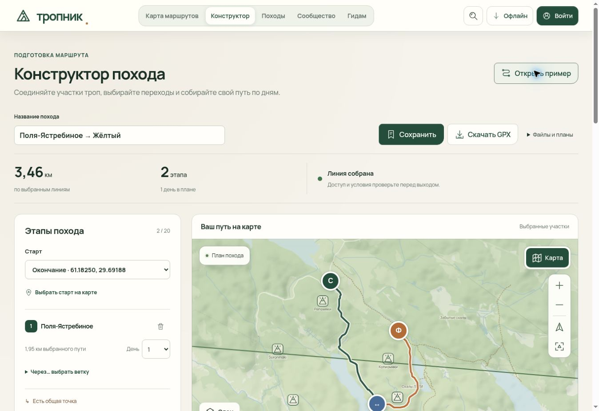

# Тропник: веб 0.4.16 и Android 0.4.17-preview

Дата выпуска: **9 ноября 2026 года**. Веб: `0.4.16`. Android: `0.4.17-preview`, `versionCode 9`, package `ru.tropa.app.preview`.

**Android опубликован:** [0.4.17-preview](https://github.com/orewn/tropnik/releases/tag/v0.4.17-preview), [успешный workflow 42649975534](https://github.com/orewn/tropnik/actions/runs/42649975534), исходники `59bbe08f0b03cae49ab5803a9fa0cde08118dcde`. Выпуск содержит исправление пустой 3D-сцены, обнаруженной при визуальном аудите 0.4.16. Это предварительный Android-выпуск с development-подписью.

Веб-версия: [Тропник](https://orewn.github.io/tropnik/) и [конструктор походов](https://orewn.github.io/tropnik/planner/). Точную опубликованную ревизию и build ID содержит [build-info.json](https://orewn.github.io/tropnik/build-info.json); [Pages workflow](https://github.com/orewn/tropnik/actions/workflows/pages.yml) проверяет их после выкладки. Веб-код и download manifest обновляются отдельно от source commit уже собранного APK.

[Машиночитаемый итог выпуска](verification/release-0.4.16.json) · [проверка изображения Android](verification/android-0.4.17-pixels.json).

## Состав выпуска

- Конструктор соединяет выбранные участки реальных геометрий: до 20 последовательных этапов, дни, начало и конец, промежуточные точки, локальные планы, резервная копия JSON и экспорт GPX. [Контракт и ограничения](composite-hikes.md).
- 277 геометрий дают 1014 кандидатов связи. Общий участок, пересечение и близость учитываются раздельно. Близость до 300 метров не превращается в подтверждённую перемычку; при разрывах GPX сохраняет отдельные участки.
- Исправлено ложное состояние готовности при нулевой длине этапа: интерфейс и доступность GPX используют согласованную проверку. Неподтверждённые переходы допускают экспорт имеющихся участков без искусственной соединяющей линии.
- Сохранены исправления мобильной карты, меню, историй, окна слоёв и паспорта безопасности. Возраст спутниковых снимков скрыт на карте; полные сведения поставщика остаются в источниках.
- Исправлена корневая ссылка карты в подвале GitHub Pages: она остаётся внутри `/tropnik/`. Regression отрисовывает настоящий Footer под двумя базовыми адресами. Исправлено склонение «29 карточек».
- Android получил вход в браузерный конструктор из каталога и карточки тропы. Перед переходом объясняются необходимость сети и хранение плана в браузере. Отмена сохраняет текущий экран; отсутствие браузера даёт видимую ошибку.
- Локальная 3D-сцена Android имеет корректный размер документа. Подтверждены видимое изображение рельефа, масштабирование, поворот, повторное открытие и восстановление после контролируемой ошибки.

## Проверки

| Проверка | Результат |
| --- | --- |
| Веб-регрессии | 332/332 PASS |
| TypeScript | 2 конфигурации PASS |
| Pages, навигация и APK | 12/12 PASS |
| Python-инструменты Android | 50/50 PASS, включая 16 проверок пути выпуска |
| Запуск встроенной 3D-сцены | 7/7 PASS |
| Граница публичного архива | 2/2 PASS |
| Android JVM | 40/40 PASS |
| Android instrumentation | 6/6 PASS на точном оптимизированном universal APK |
| Реальные пиксели и размеры 3D | 6/6 состояний PASS |
| Мобильный браузер в Pages CI | 4 профиля PASS |

В опубликованном конструкторе вручную проверена регрессия на двух реальных тропах: Поля–Ястребиное → Жёлтый показывает 3,46 км и доступный GPX; финиш в стыке обнуляет второй этап, сообщает причину и блокирует GPX; возврат финиша восстанавливает готовность. Исправленная ссылка подвала также проверена на публичном адресе.

### Реальное изображение Android

На API 35 x86_64 проверены portrait, zoom, landscape, повторное открытие, сцена до ошибки и после восстановления. В центральной области изображения получено 60–76 квантованных цветов и 6–8 неоднородных участков из девяти. Все высоты HTML/body/canvas согласованы с viewport; физические размеры WebView согласованы с плотностью экрана. Три сохранённых снимка дополнительно просмотрены вручную и независимо проверены по пикселям.

[Портретный экран](verification/android-0.4.17-scene-portrait.png) · [масштабирование](verification/android-0.4.17-scene-zoom.png) · [горизонтальный экран](verification/android-0.4.17-scene-landscape.png).

Из установленного приложения извлечён `base.apk`; размер и SHA256 совпали с build artifact и опубликованным universal APK. ARM64 проходит проверки подписи, содержимого и выравнивания; выполнение на физическом ARM64-телефоне не заявляется.

## APK, подпись и распространение

| Файл | Размер, байт | SHA256 |
| --- | ---: | --- |
| `tropnik-arm64-preview.apk` | 24 524 434 | `300bdcf1080df6f4902bd72ed1773b1a5ab4e7463a4bf7e6e7211385064bf6da` |
| `tropnik-preview.apk` | 31 680 468 | `0e197053664033c4e1ac9bedd369240b31d3385dcc4b8da0629d5028b91c7ec0` |

Сертификат SHA256: `1d1c38c1200a7f77a752f36830b3b3306d50c5c723f7aff557d7ebc6e868a26c`. Manifest SHA256: `0197dd9a172e0902af73709e1465f46eb2dc3b2873c4ec1d01343f337f018089`.

[Контрольные суммы](https://github.com/orewn/tropnik/releases/download/v0.4.17-preview/checksums.sha256) · [отчёты](https://github.com/orewn/tropnik/releases/download/v0.4.17-preview/verification-reports.zip) · [исходный архив APK](https://github.com/orewn/tropnik/releases/download/v0.4.17-preview/tropnik-0.4.17-preview-source.tar.gz).

Все шесть публичных release assets скачаны и сверены с GitHub по размеру и SHA256. Сайт использует опубликованный manifest и те же байты ARM64 APK. SHA256 в URL скачивания предотвращает подстановку прежнего файла из кэша; сборка и проверка публичного сайта сравнивают файл с manifest.

Публикация требует явного запроса версии в `tools/android-build/release-request.json`, успешных build/device jobs и проверки происхождения каждого артефакта. Тестируется тот же оптимизированный universal APK, который затем публикуется. Уже существующие release assets не перезаписываются.

Android остаётся **предварительным выпуском с development/debug-подписью**. Production signing key владельца не предоставлен; магазинная публикация не выполнена. Сертификат отличается от прежних preview, совместимость обновления поверх старой установки не заявляется. Не удаляйте старое приложение, если в нём есть нужные локальные данные.

## Исправления, найденные при выпуске

Первый CI 0.4.16 остановился до публикации из-за пустых версии и кода служебного instrumentation APK. Проверка теперь допускает отсутствие версии только у тестового пакета, сохраняя проверки его сертификата, идентификатора и доступных runner/target. Пользовательские APK по-прежнему обязаны иметь точные версию и код.

Визуальный аудит 0.4.16 обнаружил пустую 3D-сцену при формально успешных JS-проверках. Добавленная проверка реальных пикселей остановила [первую попытку 0.4.17](https://github.com/orewn/tropnik/actions/runs/42647096366) и не допустила её публикации. Диагностика показала native WebView высотой 1911 px, `innerHeight=728`, но HTML/body высотой 0; `overflow:hidden` обрезал документ. Явные `MATCH_PARENT` для WebView, CSS-высота viewport и проверка согласованных размеров устранили сбой. Поведение `WRAP_CONTENT` подтверждено [исходниками Chromium](https://chromium.googlesource.com/chromium/src/+/d0ef9df6be5983f6df7e4e050bbad4eb5030e7a2/android_webview/java/src/org/chromium/android_webview/AwLayoutSizer.java). Новый успешный прогон и реальные снимки подтверждают исправление; пороги pixel gate не снижались.

Две первые выкладки Pages превысили стандартные 10 минут при передаче файлов после успешного build. Ожидание ограничено 20 минутами; последующие выкладки и проверки публичных ресурсов прошли. Проверка точного build и APK после выкладки остаётся обязательной.

## Границы выпуска

- Конструктор Android открывается в обычном браузере. Планы хранятся локально в выбранном браузере; JSON служит переносом и резервной копией. Нативный офлайн-конструктор и облачная синхронизация не заявляются.
- Длина считается по выбранным участкам исходных линий. Время, ночёвки, проходимость и разрешения автоматически не подтверждаются. 29 карточек без геометрии не превращаются в треки.
- Подробная локальная 3D-сцена доступна для Бзерпинского района. Спутник относится к веб-карте. Полного автономного подробного покрытия России нет.
- Испытаний ARM64 на физическом телефоне, GPS, батареи и полевой навигации не было.
- К публичному статическому сайту не подключены Go/PostGIS/SMTP. Аккаунты, группы и чат не объявляются работающими серверными сервисами.
- История Telegram `poiskpohod` не предоставлена; опубликованных маршрутов из неё — 0.

Предыдущие журналы остаются историческими. [Аудит требований](ui-requirements-audit-2026-11-09.md) содержит отдельные незавершённые направления.
