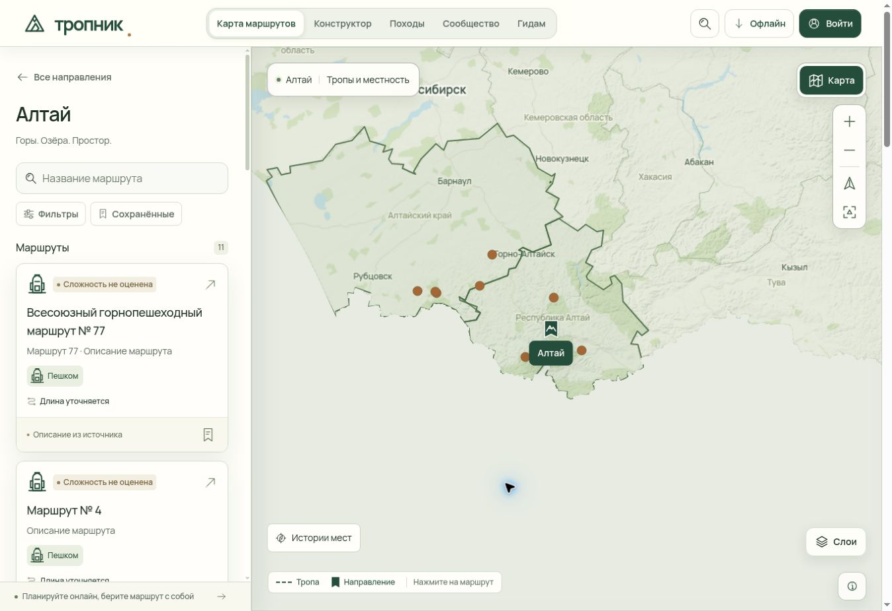

# Тропник 0.4.19: панель, читаемая карта и выбор направлений

Обновлено: 10 ноября 2026 года, МСК. **Веб-выпуск 0.4.19 опубликован. Объединённые правки двух сессий прошли полный CI: 491 web-тест, 84 проверки инструментов, четыре мобильных профиля и desktop MapLibre. GitHub Pages и закрытый Site21 успешно обновлены. На публичной странице дополнительно проверено настоящее нажатие по внешнему краю подписи «Алтай». `releasePass=true`.** Исторические неудачные прогоны сохранены ниже.

Основание — скриншоты мобильного Brave и карты Алтая, жалобы на залипающую ручку панели, прокрутку, навигацию и непрожимаемые части кнопок направлений; дополнительные требования — улучшить карту при приближении и отличать обозначения регионов от точек троп. База выпуска: `a77cffe24388e898c4dba0ec36da65a6dadf28c7`. Исправления второй сессии до `3a2026afd7e14fdebb15c4e32224a98cc8a7c588` уже являются предками коммита направлений `c25abc427c99284018ae44aa14deca021e7ff7d6`. Опубликованный source C14: `bf133e1a1040c5c46c1164dda013737191e40e1c`, локальный эквивалент: `93477dae52a077c4754b042e3753d88f319ef1f1`, совпадающее дерево: `ece82954993f48281fd8ed1dc564b5b5bd5c4f3e`. Предыдущий опубликованный веб-выпуск — [0.4.18](release-0.4.18.md).

## Итог выпуска 0.4.19

[Открыть карту Алтая](https://orewn.github.io/tropnik/?region=altai) · [Проверка и публикация 42746521929](https://github.com/orewn/tropnik/actions/runs/42746521929) · [Закрытый Site владельца](https://tropa-rf-atlas-2026.wintrybluebell1.chatgpt.site)

| Проверка | Итог на опубликованном source |
| --- | --- |
| Web, инструменты Pages, Telegram reference | **491 / 84 / 19 PASS**; счётчики разных прогонов не суммируются |
| Frozen install, lint, static client types | **PASS** |
| Статическая сборка | **339 страниц, 306 маршрутов, 52 HTTP-проверки**; build `0e74033994be61b1` |
| Браузерная матрица | **4 мобильных профиля + desktop MapLibre PASS**; исходные бюджеты и четыре точных idle-наблюдения сохранены |
| Направления | **6 touch + 2 mouse**, 128 видимых проб, 88 вне 44 px якоря; неправильных попаданий 0; 324 Leaflet-wrapper probes, перехватов 0 |
| Масштаб, навигация, панель | Быстрые серии 4+/4−, выбор точки/линии, возвраты, pan/resize и жесты панели — **PASS** |
| Режимы карты | Detail, satellite, saved overview до z18; desktop terrain 18 шагов до 17.999999982027813; обе подготовленные 3D-сцены с 28 вводами и reset — **PASS** |
| Снимки | **60** квитанций SHA/размера проверены: 27 Android + 33 desktop. Просмотрены репрезентативные финальные кадры terrain/3D/концов маршрута |
| GitHub Pages | Build и deploy **success**, 23 публичных HTTP-проверки с точными source/build ID и прежним APK |
| Закрытый Site | **Версия 21, success**, прежний owner-private доступ, revision 1 |
| Опубликованная страница | Настоящий клик по внешнему краю подписи «Алтай» открыл 11 маршрутов и изменил URL на `?region=altai` |

### Что изменилось для пользователя

Все 15 направлений получили зелёный флаг с рисунком гор, включая обозначение в легенде. Вся видимая подпись и счётчик нажимаются, даже за пределами географического якоря 44 × 44 px и после сдвига подписи для обхода соседних объектов. Скрытые оболочки не перехватывают указатель, Enter/Space сохраняют обычную активацию кнопки. Объединены исправления двух сессий: перетаскивание панели, устойчивая прокрутка, возвраты к карте, быстрые нажатия масштаба, читаемость подписей и размещение органов управления.

MapLibre 6.16.0 использует закреплённый pnpm patch: только SwiftShader выбирает RTT quality factor 1 вместо 2. При прежних DEM, mesh 128, покрытии, DPR и глубине текстура становится 1024 × 1024 вместо 2048 × 2048. В отдельной ограниченной выборке стоимость восьми hillshade-проходов снизилась на 43,1%, mipmap — на 67,1%. Равномерное ускорение всех действий не заявляется. Все сборки проверяют source/prod/dev/offline SDK до подготовки выходных файлов; ключ офлайн-кэша обновлён до `tropnik-shell-0.4.19-441824b7751ad7e2`.

### Публикация и доказательства

[Итоговый receipt](verification/web-0.4.19-final.json) связывает GitHub source `bf133e1a1040c5c46c1164dda013737191e40e1c`, локальный эквивалент `93477dae52a077c4754b042e3753d88f319ef1f1` и web tree `48683c3549aa7d3e32ea902de85e1ad65f884345`. [Полный аудитCI](verification/web-0.4.19-fourteenth-ci-audit.json) содержит проверку `assertBrowserReport`, native-ввод,60 квитанций изображений и успешную проверку публичного адреса.

Site source `588bbf1bebc9b926a051d7e919a317980b3dbe1b` побайтово совпадает по всем 1242 отслеживаемым web-файлам после сборки. Архив 39 037 193 байта, SHA-256 `47b888d0ef316bfbe2311a55c106d7211fc1ca45d6c4e3812d4a49ae303a161e`. Публикация `appgdep_6af28c6c7eac81918a05cb56180e5b85` завершилась success в 03:16:08 UTC; версия21, доступ только владельца подтверждён повторным API-чтением. Браузер закрытого адреса показал ожидаемый вход через ChatGPT; авторизованная интеракция его приложения не заявляется.

Публичная ручная проверка: точка `[777.4921875,746]` лежит вне якоря `[730,676,774,720]`, но принадлежит подписи Алтая; после нативного нажатия открыты 11 маршрутов. [Отчёт направлений](verification/region-direction-controls-2026-11-10.json) сохраняет прямоугольники и границы покрытия. Все 15 направлений охвачены общим кодом и тестами каталога/группировки; не утверждается, что каждое отдельно прокликали на физическом телефоне.

### Практические границы проверки

В проверке взаимодействий длиннейшие задачи составили 130 ms на мобильном и 351 ms на ПК, CLS 0; в более широкой фазе дизайна ПК отдельно зарегистрирована задача 1362 ms. Полный PASS не означает, что каждая отрисовка быстрее 750 ms. На предельном terrain zoom сохраняется прежняя грубая детализация и сообщение подгрузки; стабильная камера не доказывает загрузку всех сетевых деталей. [Сравнение GPU-выборок](verification/web-0.4.19-swiftshader-rtt-comparison.json) явно сохраняет эту границу и более медленный последний частичный шаг диагностики.

Выпуск относится к веб-интерфейсу. Опубликованный Android APK остаётся 0.4.18-preview, versionCode 10; новый backend/SMTP этим выпуском не развёртывался. Локальные проверки отдельных коммитов и промежуточный отклонённый Site-пакет сохранены в [локальном отчёте](verification/web-0.4.19-fourteenth-local.json) и [отчёте сборки Site](verification/web-0.4.19-fourteenth-site-build.json).

## Исторический статус C13 и предшествующих кандидатов

| Проверка / поставка | Состояние объединённого кандидата 0.4.19 |
| --- | --- |
| Полный web Node suite | C13, попытка 2, и C12 — **474/474 PASS**. Исторический CI C10 — **461/461 PASS**; результаты не складываются |
| Целевые проверки C10 | Исторический локальный прогон **47/47 PASS**; входит в соответствующий web suite |
| Отдельные регрессии кнопок масштаба | **16/16 PASS** в предыдущем прогоне; входят в общий web suite |
| ESLint | Scoped lint C12 локально и полный lint C12 в CI — **PASS** |
| TypeScript приложения и статического клиента | Обе локальные проверки C12 и типизация C12 в CI — **PASS** |
| Проверки инструментов Pages | C13 локально и в CI, попытка 2, — **84/84 PASS**; C12 — **81/81 PASS**. Исторический CI C10 — **67/67 PASS** |
| Сборки | CI C12: **339 страниц, 306 маршрутов, 52/52 HTTP-проверки PASS**, build ID `23924a7758dfc5b8`. Свежая сборка Site C12 **PASS**, source `746b438e001f6fb22e5a5904f3b1957f49112f4f`; после сборки все 1236 web-файлов побайтово сверены с C12. Публикаций не было |
| Браузерный CI: реальные touch-жесты, ПК, масштабирование | C13 [`42732799075`](https://github.com/orewn/tropnik/actions/runs/42732799075), попытка 2, — **FAILED** на desktop terrain после четырёх завершённых мобильных профилей; deploy пропущен. Первая попытка отменена до браузерного этапа. C10 и C12 также завершились отказом terrain; C11 отменён. Следующий runtime-кандидат ещё не подготовлен |
| Проверка новых областей нажатия | C9, C10 и C12: нативный touch в Leaflet и мышь в MapLibre — **PASS**, включая внешние части названий/счётчиков, группы и скрытые оболочки. Сохранены ручные Leaflet-проверки Space и iframe 390 px. Повтор на окончательном исходнике **PENDING**; физическое устройство не проверялось |
| Ручной просмотр снимков карты на разных масштабах | Сохранены исторические просмотры мобильных и desktop PNG. Полный просмотр кадров окончательного исходника **PENDING** |
| GitHub Pages и проверка публичной версии | **PENDING** |
| Существующий закрытый Site | Сборка C12 завершена, архив готов; публикация **PENDING**, доступ владельца должен сохраниться |
| Новый Android APK | В этот веб-кандидат не входит; опубликованная версия остаётся **0.4.18-preview** |

Инструментальное дополнение **C13** отправлено в main `d814cf4dd2ba091975d68d033747ba3d7c1c151b` (local `2bfa4a1b6e5fab8364e0dff45c1633bcba56a70e`, tree `8b1f1ac1713c498467f70cad7ea03b5fcc2aa863`). Оно меняет только передачу `traceEnabled` в desktop-ветке `browser-smoke.mjs` и добавляет регрессию реального цикла профилей; локально **84/84 tooling PASS**. [CI C13 `42732799075`](https://github.com/orewn/tropnik/actions/runs/42732799075) создан `2026-11-10T01:02:12Z`, ожидал C12 и затем подтверждён как **CANCELLED** в GitHub UI: build job `129555023204` отменён после 44 с, deploy job `129555350317` — после 0 с. Полный PASS C13 отсутствует. Обычный запуск C12 сохраняет тот же полный gate: отсутствие опции и явное `false` отключают только запись trace. Все 1236 web-файлов побайтово совпадают с C12, поэтому существующий Site-пакет `746b438e001f6fb22e5a5904f3b1957f49112f4f` остаётся применимым без новой сборки.

### C13, попытка 2: повторён полный отказ на рельефе

[Run `42732799075`](https://github.com/orewn/tropnik/actions/runs/42732799075), попытка **2**, source `d814cf4dd2ba091975d68d033747ba3d7c1c151b`, build `778d540d2795cef0`: **474 web /84 tooling, lint, types, 339 страниц /306 маршрутов /52 HTTP PASS**. Build job `129574782018` завершился failure; deploy `129579980489` пропущен. Камера достигла точного `17,90540610449558`, но за **15891,619 мс** появились только две конечные idle-пробы после одной движущейся. Ожидания кадров: **1260,884 /9610,535 /4712,249 мс**. Обычная полная матрица не записывала GPU trace. 6 touch и2 mouse-действия по направлениям, 128 видимых проб и324 скрытых оболочек прошли; проверены хеши52 PNG. Это не полная визуальная приёмка. [Аудит попытки2](verification/web-0.4.19-thirteenth-ci-audit.json).

### Повтор отменённого C13 и диагностика GPU

Попытка 2 [C13 `42732799075`](https://github.com/orewn/tropnik/actions/runs/42732799075) запущена 10 ноября 2026 года в 01:53 UTC на том же source `d814cf4dd2ba091975d68d033747ba3d7c1c151b`; результат **FAILED**, публикация пропущена. Первая попытка была отменена до браузерного этапа. Полная матрица, лимиты, четыре точных idle-наблюдения и нативный ввод сохранены. Новый отдельный CPU-прогон `42737687035` с побайтово тем же приложением достиг zoom 18, однако помечен `diagnosticOnly=true` и не является приёмкой релиза. Нетрейсированные высокие переходы потребляли 26,93–45,49 CPU-с в GPU-процессе, почти четыре ядра; это подтверждает стоимость программной отрисовки, но не выделяет отдельную дорогую команду. Варианты плотности 0,5, RTT 256 и наклона 30° не приняты. Итоги, хеши и границы сравнения сохранены в [диагностическом отчёте](verification/web-0.4.19-software-renderer-diagnostics.json).

### Измеренная стоимость затенения рельефа

Отдельный [GPU-прогон `42742442952`](https://github.com/orewn/tropnik/actions/runs/42742442952) на неизменённом приложении достиг zoom 18 и получил 120 корректных elapsed-query результатов без disjoint. Измерены первые восемь вызовов каждой из 15 групп; все 1115 draw-вызовов и 48 mipmap-вызовов посчитаны отдельно. Восемь offscreen hillshade-проходов по текстуре 2048 × 2048 заняли **2102,931 мс**, восемь terrain mesh-проходов — **111,042 мс**, depth — **61,146 мс**, mipmap — **171,571 мс**. Это ограниченные выборки, их нельзя умножать на полное число вызовов или считать полной стоимостью действия.

Исполнение настоящего установленного SDK отдельно подтвердило: массивы трёх направлений света не означают три исполняемых источника — текущий shader define равен **1**. Поэтому предполагаемая оптимизация «три источника → один» не реализовывалась. Адресный вариант с RTT quality factor 1 только для SwiftShader измерен отдельно, затем прошёл полный CI и вошёл в опубликованный C14. [Измерения, хеши, доказательство SDK и ограничения](verification/web-0.4.19-hillshade-gpu-diagnosis.json). Блокировка публикации снята после полного PASS C14; диагностические прогоны отдельно не считались приёмкой.

### Что объединено в текущем кандидате

- Все 15 направлений используют один SVG-флаг с рисунком гор и отдельным счётчиком в Canvas и MapLibre. Указатель в легенде также получил форму флага; круглые обозначения троп остаются различимыми.
- Вся видимая плашка и счётчик принимают нажатие, включая часть за пределами географического якоря 44 × 44 px. Названия видны без наведения, пока не скрыты движением камеры или расчётом столкновений. Пустые оболочки скрытых Leaflet-маркеров не перехватывают указатель.
- Единый обработчик отделяет нажатие кнопки от жестов карты и сохраняет нативные Enter/Space и фокус. Перед выбором отменяются устаревшие запросы GPS, очередь масштаба и автоматическое кадрирование; остановка камеры вызывается только при движении. Обработчики очищаются при удалении карты и ошибке инициализации.
- Удалены конфликтующие старые стили региональных точек. Раскладка учитывает высоту флага и подписи, а обновление текста и атрибутов не заменяет SVG и не повторяет неизменившиеся записи.
- С C10 используются публичные настройки `canvasContextAttributes.antialias:false` и `tileCountMaxMinRatio:1` для `terrain-dem` и `hillshade-dem`; соотношение векторного источника остаётся 2. В раннем terrain trace C10 исчезла многосекундная блокировка главного потока, но поздний проход рельефа всё ещё не прошёл. Это не подтверждение общего ускорения или выполнения бюджета релиза.
- На ПК и подходящих планшетных размерах строка подготовки карты располагается на 12 px выше кнопки историй. Она включена в препятствия раскладки подписей направлений и троп, а также в браузерную QA-проверку пересечений.
- Профиль наклона применяется после завершения масштабирования, в том числе при выбранном маршруте; следующая команда масштаба или движение пользователя отменяет ожидающую коррекцию. C12 запоминает уже запрошенный наклон профиля и не пытается повторно навязать его после ограничения камеры SDK; явная камера выбора также учитывается. В C12 последний terrain-шаг вернулся к точному zoom 17,90540610449558, но ожидание четырёх стабильных кадров не завершилось. На desktop панель источников сдвинута левее широкой кнопки слоёв.
- В C12 обязательная запись тяжёлых Chrome traces отключена; явная диагностика использует `TROPNIK_BROWSER_TRACE=1` или отдельный terrain-режим. C13 устраняет пропуск передачи явного флага в одной desktop-ветке полной матрицы. Полная матрица нативного ввода, производительности, точности камеры и стабильных наблюдений остаётся обязательной; диагностическая телеметрия в production-код не добавлена.

Подробности и границы ручной и нативной проверки сохранены в [отчёте направлений](verification/region-direction-controls-2026-11-10.json). Успешные нажатия не означают приёмку всего релиза.

### C12: точный масштаб восстановлен, стабильные кадры не доставлены вовремя

[CI C12 `42731010553`](https://github.com/orewn/tropnik/actions/runs/42731010553), build ID `23924a7758dfc5b8`: **474 web / 81 tooling, lint, TypeScript и статическая сборка PASS**; build job `129548705056` завершился failure на браузерном шаге, deploy `129555022257` пропущен. Завершены четыре мобильных профиля. Нативные области нажатия обоих движков повторно прошли: шесть доверенных touch-действий Leaflet и два нажатия мышью MapLibre, без потерянных видимых проб и перехватов скрытыми оболочками.

Ошибка `The maplibre map did not settle` возникла в `zoom-design-terrain`, маршрут `kavkaz-8a`. При лимите 15000 мс прошло **16283.600386 мс**, получены **три общие пробы, только две конечные idle**. Ожидания кадров: `1450.025104`, `10060.323570`, `4456.904213` мс. В первой пробе камера ещё двигалась на zoom `17.85397288980205`; последние два состояния точно одинаковы, `moving:false`, zoom `17.90540610449558`, idle-счётчик 1 → 2 при требовании 4. Нельзя считать все три пробы стабильными или объяснять этот отказ дрейфом последней неподвижной камеры.

Необязательные trace-артефакты отсутствуют, как и предусмотрено обычным запуском C12: отключение трассировки не устранило frame starvation полной матрицы. Точную причину ожидания GPU/композитора эти данные не устанавливают. Сверены хеши 52 PNG; это подтверждение целостности артефактов, не визуальная приёмка. Точные числа, SHA двух архивов и границы частичного успеха — в [аудите C12](verification/web-0.4.19-twelfth-ci-audit.json). C14 пока не имеет подтверждённых source IDs, результатов или публикации.

### C10: нажатия прошли, полная матрица завершилась ошибкой

[CI C10 `42721623552`](https://github.com/orewn/tropnik/actions/runs/42721623552), source `8f4c328b2d6b746b62d9b5172058c89bf35ea96f`, build ID `be160aa1a650a429`: **461 web / 67 tooling PASS**, сборка, lint и TypeScript прошли; публикация пропущена. Завершены четыре мобильных профиля, а проверки областей нажатия обоих движков повторно прошли: шесть доверенных touch-действий Leaflet и два нажатия мышью MapLibre вне якоря 44 × 44 px, без потерянных видимых областей и перехватов скрытыми оболочками.

Desktop terrain остановился с `The maplibre map did not settle` после точного zoom `15.90540610449558` → `16.90540610449558`. За 15,774 с пришли три из четырёх обязательных одинаковых неподвижных наблюдений; ожидания кадров — примерно 1023, 8303 и 6141 мс. Дрейф камеры в этих пробах не обнаружен. Ранняя трасса z4,905 → z5,905 показала уменьшение самой длинной задачи главного потока с 7061,741 мс в C9 до 85,251 мс в C10, но не охватывает поздний отказ и не изолирует эффекты двух настроек. Полные значения, SHA артефактов и ограничения сравнения — в [аудите C10](verification/web-0.4.19-tenth-ci-audit.json).

### C11: отменённый CI и подтверждённый диагностический блокер

C11 source `971658415202f903149190c80f8c55da9c9c5cde`; его CI `42729481252` подтверждён как **CANCELLED** в GitHub; build job `129543551564` и deploy job `129547017532` также отменены. Ранее [отдельный pitch-прогон `42729158656`](https://github.com/orewn/tropnik/actions/runs/42729158656) по `c329c3873b09a4c7efa3ee8d4ff2f2769378bb30` уже завершился с `Terrain diagnostic native zoom stopped below18`. Последовательные настоящие нажатия «+» дали zoom `16.90540610449558` → `17.853972889498323` → `17.949149000452028` → `17.94914898855987`; последнее действие не изменило масштаб. Это подтверждённый риск повторной pitch-коррекции после ограничения камеры над землёй SDK. Полная матрица C11 была отменена и не дала окончательного результата приёмки. Архив диагностики перепроверен: SHA-256 `4c0a035430077eed908122291434b8eb039d3f3b8631e9d345512afe7cbf6937`.

Для C12 объединены исправление pitch `1b7d330` и включение trace по явному флагу `c691dcd`, без диагностической телеметрии. Локальные проверки завершены: **474 web / 81 tooling, обе TypeScript, lint затронутых файлов и diff checks PASS**; [компактный receipt C12](verification/web-0.4.19-twelfth-local.json) фиксирует точный исходник и запущенный CI. Полный CI C12 завершился ошибкой, описанной в [аудите C12](verification/web-0.4.19-twelfth-ci-audit.json); локальный receipt сохраняет состояние на момент запуска. Отменённый C11 не принимается к публикации. Требования точного масштаба и четыре одинаковых неподвижных наблюдения не ослаблены.

### Ограниченные эксперименты и отложенные изменения

Холодный baseline прошёл до 18 и не воспроизвёл поздний отказ полной матрицы C10. DEM12 уменьшил число наблюдавшихся запросов с 828 до 339 и сохранил записанные состояния камеры, но ускорения высокого перехода не показал; глобальное ограничение DEM уровнем 12 не принято. Вариант видимости City также не принят: он завершился ошибкой на zoom 5,403. Эти прогоны и границы вывода сохранены в [диагностике рельефа](verification/web-0.4.19-terrain-diagnostics.json).

Ресурсный вариант с `maxTileCacheZoomLevels:3` и условным монтированием 3D тоже не доказал ускорение; его trace нельзя напрямую сравнивать по длительности с baseline из-за более широких категорий записи. В C12 остаются cache 6 и прежний жизненный цикл TerrainScene. Отдельный patch, сохраняющий ракурс и удаляющий ресурсы скрытого renderer, подготовлен и проверен локально в изолированной ветке, но не объединён: задержка повторного открытия 3D и фактический выигрыш ещё не измерены.

### C9: нажатия прошли, desktop terrain не завершён

[CI C9 `42718225706`](https://github.com/orewn/tropnik/actions/runs/42718225706), source `24639180d9f77cb56457e41e9ef5eb3a3e619332`, build ID `987c147cde39c707`: предварительные проверки прошли, публикация пропущена. В Leaflet проверены шесть нативных touch-действий, включая четыре раскрытия групп, выбор Алтая через название и Байкала через счётчик. В MapLibre два нативных нажатия мышью выбрали те же направления. Все эти точки находились вне якоря 44 × 44 px; события были доверенными. Непринадлежащих кнопке видимых контрольных точек и перехватов скрытыми Leaflet-оболочками не обнаружено. Это не измерение физического устройства и не отдельное нажатие на каждый из 15 регионов.

Desktop-проход рельефа остановился с `The maplibre map did not settle` после точного перехода zoom `15.90540610449558` → `16.90540610449558`. За 15,2 с получены только три из четырёх обязательных наблюдений: камера, прямоугольник и маршрут во всех трёх совпадали точно, `moving:false`. Ожидания кадров заняли примерно 1456, 11226 и 2209 мс. В этих данных нет дрейфа дробных координат или повторной навигации.

Полная terrain-трассировка более раннего успешного перехода z4,905 → z5,905 выявила блокировку загрузки DEM-текстур: в задаче 7061,741 мс объединённое ожидание GPU заняло 7034,606 мс, измеренное CPU-время потока — 186,808 мс. Трасса не охватывает непосредственно поздний отказ z16,905. Фактический `gl.SAMPLES` неизвестен; по ней нельзя утверждать наличие 4× MSAA или multisampling промежуточных terrain-текстур. Эти ограничения, контрольные суммы и незавершённые проверки сохранены в [аудите C9](verification/web-0.4.19-ninth-ci-audit.json). Последующий замер C10 приведён выше; пороги производительности, точное сравнение камеры и четыре обязательных неподвижных наблюдения не изменены.

### Исторический блокер C8

Дополнительно проверен [CI восьмого кандидата `42709880457`](https://github.com/orewn/tropnik/actions/runs/42709880457) по `3a2026afd7e14fdebb15c4e32224a98cc8a7c588`, build ID `11086057ed2501de`. Сборка и предварительные проверки прошли. Браузер остановился примерно через 13 минут с `The maplibre map did not settle` в desktop-проходе рельефа. Последнее настоящее нажатие «+» довело zoom с `4.9054061044955795` ровно до `5.9054061044955795`, маршрут сохранился; после этого не завершилась проверка четырёх одинаковых неподвижных состояний камеры за 15 секунд. Публикация C8 пропущена. [Подтверждённые IDs, артефакты и аудит C8](verification/web-0.4.19-eighth-ci-audit.json).

В падающий интервал попала задача главного потока длительностью **6026 мс**; в сохранённом terrain-интервале записаны 26 long tasks суммарно **48050 мс**. Это тяжёлый симптом, но конкретный стек причины в C8 не установлен: история проб камеры и длительности ожидания кадров не сохранялись, а имеющийся trace относится только к первому выбору Алтая. Точный дрейф камеры или повторная навигация этим отчётом не доказаны. Ограниченная диагностика terrain и проб settle была добавлена в C9; её результаты приведены выше. Полный Android design schema 5 в C8 прошёл, но desktop terrain, подготовленная 3D-сцена и конечные подписи тропы до конца не проверены.

### Что требуется для окончательной приёмки

Полная матрица должна завершиться на одном окончательном source commit после устранения задержек кадров desktop terrain (C14 пока ожидается): четыре мобильных профиля Leaflet и desktop MapLibre, панель и прокрутка, направление → маршрут → линия → два возврата → другое направление, доступные ступени масштаба до 18, спутник, сохранённый обзор, рельеф и подготовленная 3D-сцена. Design schema 5 дополнительно требует согласованной палитры живых тайлов и обеих полных отметок А/Б короткой тропы после настоящего перемещения карты. Для новых кнопок отдельно нужны нативные нажатия вне исходного квадрата 44 × 44 px и проверка скрытых оболочек групп.

Бюджет всей матрицы — 18 минут. Ограничения интерфейса сохранены: отдельная задача `<350 мс` mobile / `<750 мс` desktop, CLS `<0,12`, четыре быстрых нативных zoom-клика за `<200 мс` с точным итоговым масштабом. Все финальные PNG требуют просмотра; успешные измерения DOM его не заменяют.

| Поле окончательного выпуска | Значение |
| --- | --- |
| Source завершившегося с ошибкой C12 | `fff436e776e1eda12a889dd4861a92b9f5a1b813`; local `80ee91bf883226c459e8fb36e3c8bb7526683d15`; tree `8a9894fc7e23ba6384342c43c6ab5fb88104b317` |
| Workflow run C12 / результат | [`42731010553`](https://github.com/orewn/tropnik/actions/runs/42731010553), **FAILED**; build job `129548705056` — failure, deploy job `129555022257` — skipped |
| Следующий кандидат | C14: source / tree / CI IDs, результат и визуальная приёмка **PENDING** |
| Pages build ID | C12: `23924a7758dfc5b8`; окончательный принятый кандидат **PENDING** |
| Локальный receipt C12 | **474 web / 81 tooling, обе TypeScript, scoped lint и diff checks PASS**; [receipt](verification/web-0.4.19-twelfth-local.json) |
| Browser receipt и визуальный просмотр | [C12 FAILED](verification/web-0.4.19-twelfth-ci-audit.json); окончательная матрица и визуальный просмотр **PENDING** |
| Публичный Pages receipt | **PENDING** |
| Site source C12 / archive / version / deployment | Source `746b438e001f6fb22e5a5904f3b1957f49112f4f`; свежий архив проверен, все 1236 web-файлов совпадают с C12. Version / deployment **PENDING** |

[Свежая сборка Site C12](verification/web-0.4.19-twelfth-site-build.json) завершена успешно, helper завершился с кодом 0. Source `746b438e001f6fb22e5a5904f3b1957f49112f4f` отправлен; архив `tropnik-0.4.19-c12-site.tar.gz` содержит 39 031 137 байт и 1194 обычных файла, SHA-256 `bcb2d8a71c0cf234b93690bd1c993088c990e8bf4792c3a5d521d59948a83c0d`. После сборки все 1236 отслеживаемых web-файлов побайтово совпадают с C12. Архив проверен, но **не опубликован**. После ошибки полного CI C12 публикация удерживается до успешной приёмки следующего исходника; окончательный визуальный просмотр ожидается.

[Архив C11](verification/web-0.4.19-eleventh-site-build.json) сохранён отдельно как исторический и также не публиковался. Повторное чтение доступа Site `2026-11-10T00:51:46Z` подтвердило owner/custom: один пользователь-владелец, 0 редакторов, 0 групп и 0 внешних посетителей; версия Site остаётся 20, URL не изменён. Site должен остаться доступным только владельцу; публичный Pages receipt должен подтвердить окончательный commit, build ID, browser receipt и закреплённый APK. Скачанные карты, планы и пользовательские данные этим выпуском не очищаются.

### Сохранённые доказательства предыдущих итераций

Локальные результаты: [первый кандидат](verification/web-0.4.19-local.json), [исправления 3D и Canvas](verification/web-0.4.19-followup-local.json), [локальный срез runtime](verification/web-0.4.19-release-local.json), [уточнение проверки нативного ввода](verification/web-0.4.19-input-qa.json), [пятый кандидат](verification/web-0.4.19-fifth-local.json) и [восьмой кандидат](verification/web-0.4.19-eighth-local.json). Отдельно сохранены [четвёртый CI](verification/web-0.4.19-fourth-candidate.json), [седьмой CI](verification/web-0.4.19-seventh-ci.json), [просмотр desktop-кадров C7](verification/web-0.4.19-seventh-visual.json) и [чистая сборка Site C8 без публикации](verification/web-0.4.19-eighth-site-build.json).

Ни исторические отчёты 0.4.18, ни частичная матрица C7, ни сборка C8 не подтверждают приёмку или публикацию объединённого исходника. Ниже сохранена история исправлений и отдельных прогонов с их исходными результатами.

### Дополнительные исправления после первого прогона

Первый кандидат `ec94bf00ad3a170ac5bea3dc529d775a8d45269a` прошёл сборку, unit-проверки, lint и TypeScript в [Pages CI 42682420204](https://github.com/orewn/tropnik/actions/runs/42682420204). Браузерный этап остановился на скрытой в прежнем мобильном CSS кнопке сброса 3D; публикация не выполнялась. Независимый [Android CI 42682420112](https://github.com/orewn/tropnik/actions/runs/42682420112) завершился успешно без новой публикации APK.

Просмотрены все 23 сохранённых мобильных снимка этого прогона. В готовой 3D-сцене обнаружены оставшееся уведомление плоской карты, пересечение заголовка с блоком историй и недостаточный контраст текста над рельефом. Уведомление плоской карты и блок историй теперь скрыты только на время 3D. Заголовок и подпись получили компактные светлые подложки. Все шесть кнопок 3D доступны в горизонтальном ряду с областью нажатия 44 × 44 px на узких экранах, включая поворот и сброс ракурса.

`observeTerrainViewport` измеряет фактические видимые заголовок, контекст маршрута, ряд управления и нижнюю подпись. Свободная область сцены пересчитывается после завершения движения панели, при изменении размеров и в режиме уменьшенной анимации; во время drag покадрового наблюдения за стилями нет. При открытой мобильной панели второстепенные заголовок и подпись скрываются, а модель остаётся между контекстом и кнопками. Ручная проверка предпросмотра на ширинах 320 и 390 px подтвердила доступность кнопок, приближение, сброс и оба положения панели.

Уточнён и сам контроль масштабов: следующий замер выполняется после двух кадров браузера и четырёх последовательных стабильных наблюдений. Анимация Leaflet определяется на дочернем `.leaflet-map-pane`. Неприменённая очередь масштабирования больше не может ошибочно считаться нижним пределом zoom. Пороговые требования к вводу и производительности не ослаблены.

На спутниковом снимке около zoom 4,5 обнаружен вертикальный штрих на 45°E. Воспроизведение с установленным Leaflet показало щель между соседними ячейками маски: повторное независимое упрощение срезало их общий угол. Для уже подготовленной маски установлен `smoothFactor:0`; исходные GeoJSON, координаты маршрутов и viewport clipping сохранены. Локальный raster microbenchmark при 412 × 847, DPR 2 и 12 видимых ячейках дал медиану 4,53 мс вместо 0,91 мс и p95 4,87 мс вместо 1,01 мс. Это цена корректной маски в изолированном замере, а не измерение телефона; общий браузерный performance gate остаётся обязательным.

Слипание подписей областей происходило из-за того, что collision box текста не включал его светлый ореол. Штатный `Padding(4, …)` учитывает ореол и просвет, не меняя названия или якоря. Регрессия проверяет настоящую индексацию Protomaps.

Сохранённый обзор на близких масштабах не содержит полноценной детальной подложки. При zoom ≥ 6 существующая контекстная плашка обоих движков теперь постоянно показывает «Обзор без деталей», сохраняя название выбранной тропы. В Leaflet добавлено уже использовавшееся на ПК пояснение режима; оно не затирает настоящие ошибки геометрии или сети. Для спутника, подробной карты и 3D эта подпись не применяется.

### Диагностический повтор быстрой серии нажатий

Исправленный кандидат `2e9b1e5661e5e2ebb29d324991fb0228bf41be3b` прошёл 425 web tests, 25 tooling tests, lint, TypeScript и статическую сборку в [Pages CI 42687585354](https://github.com/orewn/tropnik/actions/runs/42687585354). В первом запуске браузерная проверка отклонила серию «−»: все четыре настоящих клика дали ожидаемый zoom 12,5877216 → 9,5877216, однако поступали 1535,5 мс вместо требуемых менее 200 мс. Публикация была пропущена. Серия «+» на том же кандидате уложилась в 101,7 мс.

Паузы возникли между `pointerdown` и `pointerup` третьего и четвёртого касаний; после отпускания `click` приходил через 1–2 мс. Самая длинная зарегистрированная задача главного потока — 191 мс, CLS — 0. Этого недостаточно, чтобы однозначно отделить ожидание CDP, compositor и несколько коротких задач отрисовки. Запущен один диагностический повтор того же SHA с неизменными проверками. [Сохранённое доказательство первого запуска](verification/web-0.4.19-burst-attempt1.json) остаётся частью журнала независимо от результата повтора.

Диагностический повтор также остановился на старом генераторе: четыре «−» пришли за 1263,1 мс при точном итоговом масштабе, CLS 0 и максимальной задаче 96 мс. Дальнейшие повторы без изменений не выполнялись.

Первичный [код ChromeDriver](https://chromium.googlesource.com/chromium/src/+/refs/heads/main/chrome/test/chromedriver/chrome/web_view_impl.cc) подтверждает пакетную отправку touch-событий без ожидания каждого промежуточного ответа. Генератор проверочной серии теперь последовательно отправляет восемь нативных событий через одно соединение, затем ожидает все ACK и передаёт каждую ошибку. Проверяются четыре настоящих `pointerdown → pointerup → click`, фактический click-span менее 200 мс, точный накопленный масштаб и прежний бюджет ожидания. Добавлены время отправки/ACK каждой команды, задержка первого ввода и последние 32 long tasks; обязательная схема design report повышена до 3. Это исправление генератора проверки, а не доказательство, что прежняя задержка целиком была вызвана инфраструктурой.

### Проверка причинного порядка нативных нажатий

Кандидат `c903cfc4dc384eb2d18470910d4e14edb53f3a71` прошёл 430 web tests, 26 tooling tests, lint, типизацию, сборку и 52 HTTP-проверки в [Pages CI 42692408598](https://github.com/orewn/tropnik/actions/runs/42692408598), build ID `3a61987c02229aa1`. Четыре нативных «+» дали точный масштаб 9,5877216 → 12,5877216: click-span 1,1 мс, все восемь ACK за 18,65 мс, задержка первого ввода 15 мс. Во время прохода масштабирования CLS оставался 0, максимальная зарегистрированная задача — 84 мс. Это данные стенда Chromium, не физического телефона.

Публикация снова была остановлена проверкой: новое условие требовало полного чередования `down → up → click` для каждого касания. Chromium доставил четыре упорядоченные пары down/up, затем четыре соответствующих click. [Сохранённая трасса](verification/web-0.4.19-native-click-order.json) показывает точный итоговый масштаб и все настоящие события. [Pointer Events §4.2.12](https://www.w3.org/TR/pointerevents3/#the-click-auxclick-and-contextmenu-events) и [Chromium GestureManager](https://chromium.googlesource.com/chromium/src/+/refs/heads/main/third_party/blink/renderer/core/input/gesture_manager.cc) связывают click с исходным указателем и отпусканием, а не требуют завершения click до следующей пары.

Проверка уточнена до причинного порядка: четыре чередующиеся пары, четыре упорядоченных trusted click, одинаковые pointerId/type каждой связки, каждый click после собственного up по индексу доставки. Timestamp может совпадать с timestamp отпускания; он не является единственным ключом. Пороги фактического click-span менее 200 мс, точного масштаба, четырёхсекундного ожидания и проверки всех ACK сохранены. Runtime приложения и Site-пакет не меняются от этого уточнения QA. Следующий точный commit всё ещё требует полного браузерного прохода и просмотра кадров.

### Четвёртый кандидат: мобильная приёмка и отказ на ПК

Кандидат `e0f64d25584fce2734d0cd54a70b6768d9e85baf`, tree `7311f0bf693a885a96731b8b7c23a422d4b6d90f`, проверялся в [Pages CI 42695928146](https://github.com/orewn/tropnik/actions/runs/42695928146), job `129427637824`, build ID `b8f327b3aedcf49b`. Исторический срез этого прогона: **430/430 web tests, 29/29 Pages tests, lint, типизация статического клиента, сборка и 52 HTTP-проверки — PASS**. Эти числа относятся только к четвёртому кандидату; результаты последующих итераций приведены в их разделах и отчётах.

Все четыре мобильных профиля — compact Android, iPhone portrait, Android portrait и phone landscape — прошли настоящие touch-жесты панели, прокрутку и проверки историй. Android/Leaflet дополнительно прошёл выбор направления и маршрута, линию, два возврата и другое направление. Детальная карта и спутник проверены на **24 ступенях каждый до zoom 18**; сохранённый обзор — на шести ключевых масштабах, 3D — с приближением, отдалением и сбросом. Четыре нативных «+» дали 9,5877216 → 12,5877216, четыре «−» вернули 9,5877216; click-span составил 0,7 и 0,6 мс, все ACK получены, причинный порядок и выбор маршрута сохранены. В проходе масштабирования CLS — 0, максимальная задача — 73 мс.

По пикселям просмотрены **все 24 исходных мобильных PNG**, их хэши сверены с манифестом. Прежняя щель маски под Кавказом отсутствует; подписи областей разделены, контекст «Обзор без деталей» читается, все шесть кнопок 3D видимы, сброс возвращает удобный общий кадр. Атрибуция спутника сохранена, возраст снимка скрыт, предел детализации обозначен. Это ограниченная приёмка: desktop-кадров нет, выбранная линия на z18 находится вне кадра, а отметки А/Б и открытая мобильная панель не представлены в этой матрице. Проверка PNG не подменяет проверку жестов или физического телефона.

На ПК второй возврат к направлениям не завершился: документ сместился на **117 px**, кнопка «Все направления» оказалась на `y=1` под `HEADER`, панель — на `top=-45`. Отдельно зафиксирована задача **790 мс** после первого выбора Алтая при бюджете 750 мс. Проверка performance ещё не была достигнута: сценарий раньше остановился на перекрытой кнопке. Причина задачи не установлена; отсутствие performance assertion не означает прохождение бюджета. Desktop zoom audit не начался. **Публикация четвёртого кандидата не выполнялась.** Подробности и контрольные суммы — в [receipt](verification/web-0.4.19-fourth-candidate.json).

### Пятый кандидат: восстановление истории и ранний отказ запуска CI

Explore теперь получает `history.scrollRestoration='manual'` до создания записей своей навигации. Восстановление прежнего режима при `pagehide` и cleanup, повторное получение при `pageshow` отделяют возвраты внутри карты от переходов между документами. Обычная прокрутка не перехватывается. Изменение закрывает подтверждённый путь смещения карты под закреплённый header; отдельная ограниченная трассировка первого desktop-выбора подготовлена для расследования 790 мс, без прогрева и изменения бюджетов.

Ручная проверка свежего предпросмотра в управляемом браузере, **с Leaflet fallback**, прошла два возврата: маршрут → регион оставил документ и список на 0, кнопку Back на `top=96` с попаданием в `BUTTON`; регион → направления оставил документ на 0. Настоящий переход по ссылке в шапке на `/planner` и браузерный Back восстановили исходный scrollY **1542**. Первый промежуточный замер был **1073** при ещё не загруженном ленивом footer; после восстановления высоты документа итог снова составил 1542. Промежуточное положение не объявляется финальным результатом.

Полная локальная проверка пятого кандидата: **432/432 web tests, 35/35 Pages tests, ESLint 0 ошибок / 0 предупреждений, оба TypeScript-прогона — PASS**. [Локальный receipt](verification/web-0.4.19-fifth-local.json) сохраняет эти результаты и ручные проверки. В [CI 42700891491](https://github.com/orewn/tropnik/actions/runs/42700891491) exact commit `1323836e8b822fe3f0c6295a138fc455532ddf59` прошёл 432 web / 35 tooling tests, lint, типизацию, статическую сборку `75acee80d3a9de91` и 52 HTTP-проверки. Браузерный шаг остановился через 8,28 с на `ECONNREFUSED` управляющего порта Chromium, до первого профиля и до трассировки. Ни исправление Back на MapLibre, ни performance gate этим запуском не проверены; публикация пропущена. [Receipt раннего отказа](verification/web-0.4.19-fifth-ci.json). Причина запуска не установлена: старый обработчик не сохранил stderr в этом сценарии. Шестой кандидат добавляет ограниченное ожидание готовности одного запуска, раннюю обработку spawn/exit, bounded stderr и завершение процесса; пользовательские пороги задержек не меняются.

### Дополнительная проверка короткой линии на разных масштабах

Ручной просмотр Leaflet на `kavkaz-8a` подтвердил читаемую выбранную линию при z14,02 и z18; сохранены исходные снимки. Для этого составного маршрута края А/Б намеренно не назначаются. Поэтому отдельный сценарий проверен на `osm-relation-2244794`: одна исходная часть, 12 вершин. На z11 два видимых маркера 32×32 px оказались на расстоянии около 6 px и перекрылись; подписи шириной около 62 px усугубляли наложение. [Ручное доказательство](verification/web-0.4.19-preview/preview-review-before-sixth.json) сохраняет этот отказ отдельно от успешных кадров линии.

Шестой кандидат получает общую экранную плотность А/Б: скрывать обе аннотации, если два badges не помещаются с просветом; показывать только буквы при промежуточном расстоянии; показывать подписи, когда их блоки разделены. Геометрия, координаты и смысл исходных краёв не меняются. Отдельный нативный сценарий короткого маршрута добавляется для Leaflet и MapLibre. Ручная проверка трёх состояний прошла: z11 — hidden, z14 — compact, z16,25 — full, с сохранением линии и раздельными подписями. [Снимки и receipt](verification/web-0.4.19-preview/preview-review-sixth.json). Полная локальная проверка шестого кандидата: **438/438 web, 45/45 tooling, оба tsc и ESLint 0/0 — PASS**, [receipt](verification/web-0.4.19-sixth-local.json). Нативный аудит обоих движков на z11/14/17 и его три PNG стали обязательны в schema4. Результат последующего CI шестого кандидата приведён ниже; эта локальная проверка сама по себе не подтверждала его прохождение.

### Сокращение проекции невидимой маски

Отдельно устранён измеренный дорогой путь приложения: Leaflet проецировал все 864 ячейки и копии мира при каждом zoom. `maskViewportCulling` отсекает полностью невидимые ячейки по сохранённым bounds до проекции, рассчитывая один общий viewport на проход. При pan без изменения zoom ранее отсечённая ячейка снова проецируется при входе в буфер; при недоступном viewport сохраняется обычная проекция.

В проблемном диапазоне число вызовов проекции уменьшилось с 864 до 1, вершин — с 140 490 до 7807 (−94,4%). При z4,5 осталось 12 ячеек, при обзоре страны z1,34 — 264. Тесты на установленном Leaflet сравнивают все координаты видимых колец после clipping: результат совпадает с исходным renderer при pan, обратном pan, zoom-out, resize и переходе между копиями мира. Исходная геометрия и растеризация не меняются. Нет новых циклов RAF, обработчиков DOM или remove/add слоёв. [Локальный замер](verification/web-0.4.19-mask-performance.json) показывает стоимость именно проекции; он не заменяет проверку FPS на телефоне.

## Причины залипания

### Ручка была кнопкой без перетаскивания

В `Explore.tsx` у ручки имелся только `onClick`. Вертикальное движение не меняло положение панели, а `touch-action:manipulation` разрешало браузеру забрать жест под прокрутку страницы. Ручная проверка исходного поведения в облачном браузере при размере 390 × 844 подтвердила: перетаскивание мышью не открывало панель.

Добавлен контроллер `web/lib/sheet-gesture.ts`. Ручка и свёрнутый блок с названием теперь захватывают указатель и перемещают панель вместе с ним. Список маршрутов сохраняет нативную прокрутку.

### Высота списка менялась во время прокрутки

У карточек в панели использовались `content-visibility:auto` и приблизительная высота 132 px. В просмотренном каталоге настоящие карточки занимали 262–338 px. По мере появления карточек на экране браузер заменял приблизительные размеры настоящими, меняя общую высоту списка и положение ползунка.

Для `.explore-panel-content .trail-card` отключены приблизительные размеры и отложенное отображение: карточки получают `content-visibility:visible` и `contain-intrinsic-size:none`. Изменение действует в панели на телефоне и ПК. Сохраняется выдача по 12 карточек; остальные области сайта не затронуты. На границе списка разрешён естественный переход к прокрутке страницы.

### Движение панели могло запускать перерасчёт карты на каждом кадре

Старый наблюдатель Leaflet следил за `class` и `style` панели. Запись нового `transform` при каждом движении пальца могла вызывать `invalidateSize`, повторное определение обзора России и расчёт камеры.

Наблюдение за стилем панели удалено. Реальные изменения размеров по-прежнему обслуживает `ResizeObserver`; окончание перемещения — `transitionend`. Для мгновенного завершения и режима уменьшенной анимации предусмотрено одно событие `tropnik:sheet-settled`. Ручное управление камерой сохраняет приоритет над автоматическим кадрированием.

### Быстрые нажатия масштаба терялись во время анимации

В локальном браузере подтверждён отдельный сбой Leaflet: четыре быстрых нажатия «+» с zoom 14 доводили карту только до 16,25 вместо ожидаемых 17 при шаге 0,75. SDK мог проигнорировать новую команду во время перехода; чтение промежуточного масштаба также не сохраняло суммарное намерение пользователя.

Для обоих движков добавлен общий `MapZoomButtons` в `web/lib/map-zoom-buttons.ts`. Каждое нажатие изменяет накопленную целевую величину. Контроллер хранит одну последнюю цель, ждёт окончания занятого SDK и применяет её в следующем кадре. Границы масштаба проверяются перед применением. Ручной жест, новая навигация и удаление карты отменяют устаревшую цель и ожидающий callback.

Повторная проверка настоящими нажатиями в облачном браузере: **14 + 4 × 0,75 = 17**, затем четыре «−» возвращают **14**. Отдельные 16 unit-тестов прошли и входят в полный suite из 430 тестов. Это проверка сохранения ввода, а не измерение FPS.

### Очистка Canvas при закрытии карты

При обновлении предпросмотра обнаружена ошибка `clearRect` после удаления холста. Регрессия на установленном Leaflet 1.9.4 воспроизвела причину: синхронный `_updatePaths → _redraw` терял ID уже запланированного RAF, поэтому `onRemove` не мог отменить его перед удалением контекста.

`createLeafletCanvas` отменяет сохранённый redraw request до штатной перерисовки и проверяет наличие контекста. Обёртка применяется только к трём собственным Canvas-рендерам: основному, суши и маски. Глобальный prototype SDK и `map.remove` не изменяются. Проверены исходное падение, отмена потерянного кадра, сохранение чужих callbacks, поздний callback после удаления и настоящее рисование после повторного добавления рендера. В браузерном предпросмотре выполнены переход в конструктор, возврат к выбранному маршруту и открытие 3D.

## Как теперь работает панель

- Во время движения выполняется максимум одна запись `transform` за кадр. В `pointermove` нет чтения геометрии элементов и обновления состояния React.
- При отпускании выбирается открытое или свёрнутое положение по позиции и недавней скорости. Скорость, оставшаяся от движения до длительного удержания, не вызывает ложный рывок.
- Смена направления следует за пальцем без повторного начала жеста. Повторный захват во время анимации начинается с видимого положения панели.
- Отмена касания, потеря захвата, второй указатель, изменение размеров, внешняя навигация и удаление компонента очищают незавершённый жест.
- Синтетический клик после перетаскивания не переключает панель второй раз. Следующее настоящее нажатие и управление клавиатурой остаются доступными.
- Завершение перемещения занимает 200 мс; прямое движение под пальцем не анимируется. При `prefers-reduced-motion` завершающая анимация отключена. Специфичность правил исправлена для обоих классов `expanded` и `collapsed`.
- Ручка сохраняет область нажатия 44 px. Перетаскивание не устанавливает обработчики на прокручиваемый список.

В локальном предпросмотре облачного браузера после изменения настоящим движением мыши открыты и ручка, и свёрнутый блок. Прокрутка страницы при проверенном движении ручки оставалась нулевой; временные стили очищались. Это не проверка touch-ввода на физическом Android/Brave.

## Оформление карты при приближении

Оформление согласовано между мобильным Canvas и desktop MapLibre:

- Выбранная линия получила сплошной лесной цвет и светлую обводку; толщина плавно меняется в ограниченном диапазоне 3–5 px.
- Территориальная заливка и административные границы становятся менее заметными при приближении, освобождая внимание для троп, воды и рельефа.
- Различие между лесом, открытой местностью, водой, дорогами и зданиями усилено в существующей палитре. Толщины линий ограничены и зависят от масштаба.
- Подписи приведены к читаемой иерархии. Крупные обзорные названия имеют верхний предел масштаба; местные подписи появляются при приближении. В Canvas используется имеющаяся Manrope.
- Название выбранной тропы занимает существующее место контекстной плашки карты; дополнительная перекрывающая карточка не добавляется.
- Для одной непрерывной исходной линии показываются максимум две пассивные отметки А и Б. Они обозначают края геометрии, а не рекомендованные места входа, старт и финиш похода. Для составной геометрии порядок не придумывается; для замкнутой линии используется одна объединённая отметка. Маркеры не перехватывают касания карты.
- На узком портретном экране с открытой панелью кнопки масштаба и положения собраны над ней в горизонтальный ряд; переключатель слоёв занимает отдельное место слева. Области нажатия 44 px сохраняются.
- На ПК уведомление карты перенесено под контекстную плашку: в просмотренном состоянии оно перекрывало блок историй. Кнопка подтверждения уведомления сохраняет область не менее 44 × 44 px.
- В спутниковом режиме легенда получила светлую подложку, чтобы линии и подписи оставались различимыми поверх снимка.

Координаты маршрутов, расстояния, порядок исходных сегментов и признаки доступа этими правками не меняются. Наличие красивой линии не означает подтверждённую проходимость маршрута. Источники и лицензионные сведения сохраняются.

## Расширенная браузерная приёмка

Подготовлен новый обязательный формат browser report, который не принимает старое доказательство только нажатия кнопки:

1. Настоящие touch-перетаскивания панели в обе стороны и повторное открытие/закрытие на четырёх мобильных профилях.
2. Измерение положения в середине жеста: отклонение панели от пальца не более 3 px, без прокрутки страницы и изменения высоты панели.
3. Смена направления, отмена касания, работающее нажатие после отмены и после drag, сохранение прокрутки списка.
4. Настоящий свайп каталога маршрутов: список прокручивается, положение панели и страницы сохраняется, высота содержимого не скачет.
5. Сохранённые проверки карты: направление → маршрут → линия → возврат → другое направление, затем масштабирование, перетаскивание и изменение окна; отдельно мобильный Leaflet и ПК MapLibre.
6. Новый проход по доступным ступеням масштаба до zoom 18 на мобильной и ПК-карте. На ключевых масштабах 2, 5, 8, 11, 14 и 18 сохраняются снимки для визуальной проверки.
7. Отдельно фиксируются спутниковый режим, сохранённый обзор, доступный рельеф и подготовленная 3D-сцена. Ошибка загрузки внешних изображений записывается как ошибка или fallback; её нельзя объявить успешно показанным спутником или 3D.

Проверки данных стиля уже исполнялись локально: выражения MapLibre проходят проверку установленной библиотекой, числовые параметры обоих движков проверяются на масштабах 0–18. Это подтверждает корректность значений, но не заменяет просмотр реальной карты. Результаты мобильной части четвёртого кандидата и последующих C6/C7 сохранены в истории. **Для объединённого исходника ещё требуется полный CI и финальная визуальная приёмка; актуальное состояние приведено в верхней таблице.**

Изменения только в `docs/` и `README.md` больше не запускают новую публикацию Pages. Изменения приложения, зависимостей, инструментов проверки и workflow продолжают проходить полный обязательный процесс; ручной запуск сохранён.

## Границы утверждений

Физический телефон пользователя и его Brave не проверены. Конкретный FPS, отсутствие любых задержек на всех устройствах и доступность внешних тайлов не заявляются. Эта итерация не заменяет Android APK, не развёртывает backend/SMTP и не меняет состояние внешних интеграций, описанное в [аудите исполнения](runtime-audit-2026-11-09.md).

## Шестой CI и седьмая диагностическая итерация

[CI 42703339818](https://github.com/orewn/tropnik/actions/runs/42703339818), commit `92a3604ab248df0fd6dfc660d328d87613e58f62`, build `185d036259217274`: 438 web / 45 tooling tests, lint, типы, статическая сборка и 52 HTTP-проверки прошли. Четыре мобильных профиля прошли с CLS 0; максимальная задача мобильной карты — 151 мс, zoom-прохода — 85 мс. Получены 27 PNG и native source-end проверка на z11/14/17. [Подробный receipt](verification/web-0.4.19-sixth-ci.json).

На ПК оба возврата и остальные функциональные проверки выполнены. Проверка скорости обнаружила задачу 759 мс при прежнем строгом лимите менее 750 мс. Она началась через 946,8 мс после первого выбора Алтая. Следующая задача заняла 373 мс. Публикация пропущена.

Trace имеет `dataLossOccurred:true`: 2 MiB буфера хватило только на 1324,7 мс событий, и задача 759 мс в сохранённые события не попала. Нельзя приписывать её шейдерам, обработчикам или layout без новых данных. В следующем диагностическом прогоне исключаются дублирующие `toplevel`/`v8.execute`, буфер ограничен 16 MiB, экспорт — 32 MiB; исходные пределы записи 8 секунд, drain 5 секунд и close 1 секунда сохраняются. Переполнение остаётся явным `partial`, что проверяется регрессией.

Ошибки скорости ПК собираются до конца визуальной матрицы так же, как мобильные. Условие `<750 мс` и блокировка публикации сохраняются; отдельный тест отвергает границы 350/750 мс даже при наличии полного набора кадров. Локально инструменты: 47/47 PASS. Runtime приложения и подготовленный Site-пакет этой диагностической итерацией не меняются.

### Восьмой кандидат: исправления по визуальным доказательствам

[Седьмой CI](verification/web-0.4.19-seventh-ci.json), commit `03de50de8ad25827199dff7f8ec0abf8d36128e8`, run `42706247348`, build `1a4d63078526e788`, завершён timeout браузерного шага после 12 минут. Сохранены 27 мобильных и 23 desktop PNG; на ПК закончены detail, satellite и сохранённый обзор, но прерваны рельеф, 3D и короткая тропа. Финальный performance gate не достигнут, публикация пропущена. Полный trace без потерь показал задачи 408,030 и 265,223 мс: в них основное ожидание связано с первой линковкой программ circle и hillshadePrepare в SwiftShader. Это не доказанная причина прежних 759 мс, поскольку прошлый trace не содержал тот участок.

Квадратный непрозрачный тайл на короткой тропе возникал из-за палитры overview, захваченной при создании задания. `setOverview(false)` раньше не обновлял уже нарисованные и выполняющиеся тайлы. Теперь живые тайлы обновляются через ту же ограниченную очередь, stale worker result не рисуется, старый callback завершения не повторяется, а быстрая смена туда и обратно переиспользует правильные пиксели. Бюджеты 48 заданий / 3 загрузки / 1 worker / 8 MiB сохранены; DEM не удерживается в новой коллекции. 16 поведенческих регрессий покрывают смену режима, ошибки, отмену, уничтожение и очередь из 51 живого тайла.

Раскладка подписей теперь отделяет DOM-чтения от записей: начальные записи, измерения, перевороты, повторный замер только перевёрнутых подписей, чистый расчёт столкновений и итоговое применение. Это убирает повторный forced layout между соседними подписями, сохраняя исходные координаты, приоритет выбранных объектов и области нажатия 44 px. Шесть DOM-тестов проверяют порядок, идемпотентность, приоритеты и геометрию. Отдельный сравнительный прогон 1 000 состояний совпал с прежней геометрией; это не измерение FPS на устройстве.

Светлая подложка легенды, уже использовавшаяся на спутниковом слое, применяется ко всем режимам 2D. Она сохраняет читаемость над тёмным рельефом; размеры, цвета и радиус взяты из действующего оформления. Мобильное скрытие легенды сохранено.

Browser receipt schema 5 требует совпадения желаемой и реально нарисованной палитры видимых тайлов. Проверка короткой тропы на z17 при необходимости перемещает карту настоящим touch/mouse drag, сохраняет до и после, trusted pointer events и все ACK, затем проверяет оба полных обозначения А/Б вне препятствий интерфейса. SDK-камера и географические координаты не подменяются. Алгоритм отдельно проверен на реальных семи препятствиях desktop-кадра. Полная новая матрица ещё должна подтвердить эти изменения.

Для всей матрицы выделено 18 минут вместо исчерпанных 12; ограничения отдельной задачи `<350 ms` mobile / `<750 ms` desktop, CLS и быстрого ввода не меняются. После каждого завершённого профиля и взаимодействий сохраняется диагностический `browser-progress.json` с `verified:false`, чтобы внешний timeout не терял уже измеренные показатели. Итоговый gate остаётся обязательным.

Локальные проверки восьмого кандидата: [receipt](verification/web-0.4.19-eighth-local.json). Пока они не заменяют CI и проверку опубликованного выпуска.
