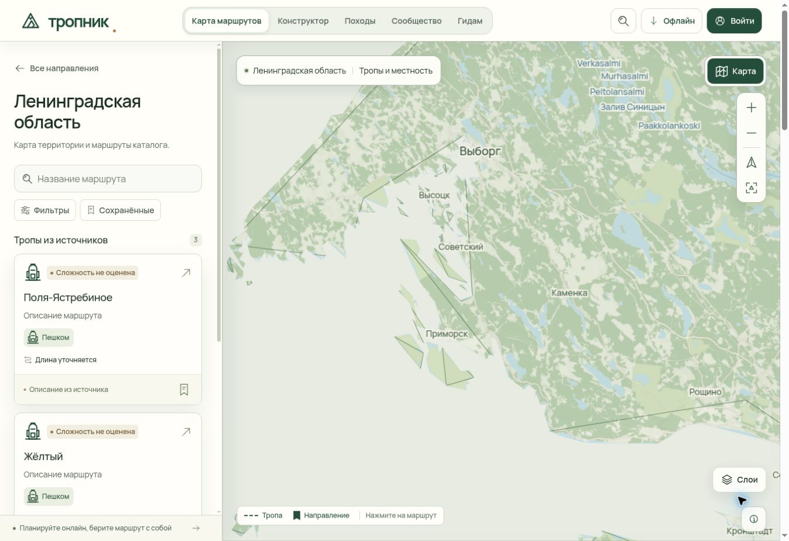
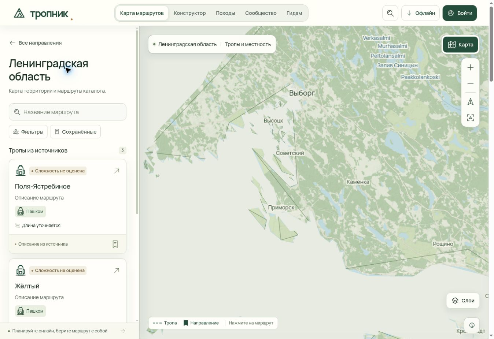

# Тропник 0.4.22: цельные подписи у границы карты

Дата: 10 ноября 2026 года. Веб-исходники: `1ab1aee0193b6f432004601deede43125c0ef283`. Site-исходники: `09d713e3376a9293b6681ed905bea1134863c857`; 21 изменённый web-файл побайтово совпадает между двумя исходными деревьями.

Владелец сообщил, что географическая маска продолжает обрезать названия у Выборга, Светогорска и побережья Финского залива. Ошибка воспроизведена в браузере: на общем виде области маска также закрывала часть названия Санкт-Петербурга.

## Изменение

Подпись теперь проверяется как географический объект и рисуется целиком над маской. Контур и географическое покрытие карты сохранены. Название на русском языке или попадание в список крупных городов само по себе не разрешает показ иностранного объекта.

- **Leaflet / Protomaps:** геометрия подложки и прозрачный слой текста разделены. Географическая проверка применяется к каждому фактическому якорю подписи до расчёта столкновений; сохраняются весь текст, обводка и исходные правила размещения. Оба слоя используют один `View` / `TileCache` и вместе удаляются при переходе в обзор или отключении детальной карты.
- **MapLibre:** все 12 базовых символьных слоёв используют один проверенный GeoJSON-источник над маской. Он получает объекты из уже загруженных тайлов через публичный API. Исходные фильтры и диапазоны масштаба применяются до геометрической проверки; события собственного источника не запускают повторное обновление.
- **География:** точечные объекты проверяются по покрытию. Для линий проверяются все сегменты в проекции Mercator, включая пересечения с узкими заливами и отверстиями. Неопределённая или недопустимая геометрия не поднимается над маской. Это консервативное правило может скрыть подпись линии, пересекающей внешнюю границу.
- **Жизненный цикл:** смена стиля отменяет устаревшее отложенное обновление, а неизменные данные повторно не отправляются в renderer. Совпавший локальный ID разных объектов не удаляет одну из подписей. Координаты около 180° приводятся к непрерывному отображению.
- **Автономный просмотр:** оба пути используют те же helpers; зависимости добавлены в оболочку service worker, версия кэша обновлена.

## Проверки

| Проверка | Результат |
| --- | --- |
| Полный web-набор | 557 PASS, 0 FAIL, 0 SKIP |
| TypeScript приложения и статического клиента | PASS |
| Сборка Site | PASS |
| Сборка Pages | 339 страниц, 306 справочных маршрутов, 52 HTTP-проверки |
| Браузерный CI | 4 мобильных профиля и desktop MapLibre — PASS; масштабирование до 18 |
| Проверка опубликованной сборки | PASS, 23 HTTP-проверки, build `9f1f4d389f00307a` |
| Географический допуск Canvas | 0–18 с шагом 0,25, дополнительно 7,06188; 4 884 проверки закреплённых точек с копиями мира |
| SDK | Настоящие Protomaps Labeler / LineLabelSymbolizer / TileCache и установленный MapLibre style-spec |
| Ручная проверка | Leaflet: зумы 7,06188; 8,56188; 9,31188; телефон 390 × 844 на зуме 5,42598 |
| Переключение подложки | Detail → satellite → overview → detail; в обзоре 0 canvas подписей, после возврата подписи восстановлены |

На записанных браузерных сценах целиком видны «Выборг», «Высоцк», «Советский», «Приморск» и «Санкт-Петербург». Снимок ниже относится к локальному управляемому preview; это не утверждение о визуальной проверке каждого возможного положения камеры. Браузер этой ручной проверки использовал Leaflet, WebGL проверяется отдельным CI-профилем.

### Публичная карта после выкладки

На опубликованной странице Ленинградской области повторно проверены масштабы 7,06188 → 8,56188 → 9,31188. В том же ракурсе общего вида теперь целиком читаются «Выборг» и «Санкт-Петербург»; при приближении целиком видны «Высоцк», «Советский» и «Приморск».

[Машиночитаемая квитанция](verification/web-0.4.22-map-labels.json) · [Полный web-прогон](verification/web-0.4.22-tests.txt) · [CI / публикация Pages](https://github.com/orewn/tropnik/actions/runs/42808876819).

Диагностический замер на 16 настоящих локальных PBF-тайлах z14: 146 отобранных объектов, 68,5 КиБ GeoJSON, медиана повторного обновления 3,9 мс; первый проход после построения индексов 41,3 мс. Холодное построение индексов измерено отдельно, около 112 мс. Это измерения Node, а не FPS браузера и не гарантия одинаковой скорости на всех устройствах.

## Проверка начальной камеры

Первый Pages-прогон [42806071331](https://github.com/orewn/tropnik/actions/runs/42806071331) остановился на браузерной проверке короткого маршрута: камера оставалась на зуме 7 вместо 14. Начальный ResizeObserver принимал временную обзорную камеру за запрос пользователя и отменял ещё ожидающее приближение к маршруту.

Исправление различает начальную камеру и явно выбранный обзор. Новая выбранная карточка сохраняет право на первоначальное кадрирование; ручное движение или Home его отменяют. Явный обзор с открытой карточкой продолжает перестраиваться при изменении размера окна. Добавлены проверки отложенной загрузки и реального расчёта камеры при переходе 1000 × 700 → 412 × 700 → 1000 × 700. Нативная ручная проверка того же короткого маршрута подтвердила переход с ошибочного зума 7 на 14. Требования браузерного аудита не менялись.

## Публикация

Закрытый Site владельца успешно обновлён: deployment `appgdep_6af301dfa7648191bd37cd073f33c868`, прежняя аудитория сохранена. Публичный Pages-прогон `42808876819` завершился успешно: build и deploy — success, окончание 10.11.2026 в 11:52:38 UTC. После выкладки проверены build ID `9f1f4d389f00307a`, исходный commit, итоговый browser report и 23 публичных HTTP-ресурса. Живая карта также осмотрена вручную после перезагрузки.

В CI обе проверки концов короткой тропы стартовали на зуме 14; диапазоны до 18, быстрые последовательности зума и переключение слоёв прошли. Просмотрены два снимка desktop MapLibre из артефакта `13762555151`: detail z8,91 и короткая тропа z14.

В полном проходе desktop со всеми режимами зафиксирована отдельная длинная задача 1254 мс; действующие критерии CI пройдены. Этот результат не заявляет отсутствие длинных кадров в тяжёлом рельефе или одинаковую производительность всех устройств.

## Унаследованные исправления 0.4.21

Предыдущий выпуск этой работы опубликован из `a1da863683e1e7f3e26b64c0d6fdfe14b918c1b7`; [CI 42801636444 завершился успешно](https://github.com/orewn/tropnik/actions/runs/42801636444). В нём исправлены возврат камеры от маршрута к региону, позднее автоматическое кадрирование после ручного движения, ширина мобильного каталога, поиск по обновлённому каталогу, перенос статуса закрытого маршрута, восстановление клавиатурного фокуса и повторные записи истории при поиске.
